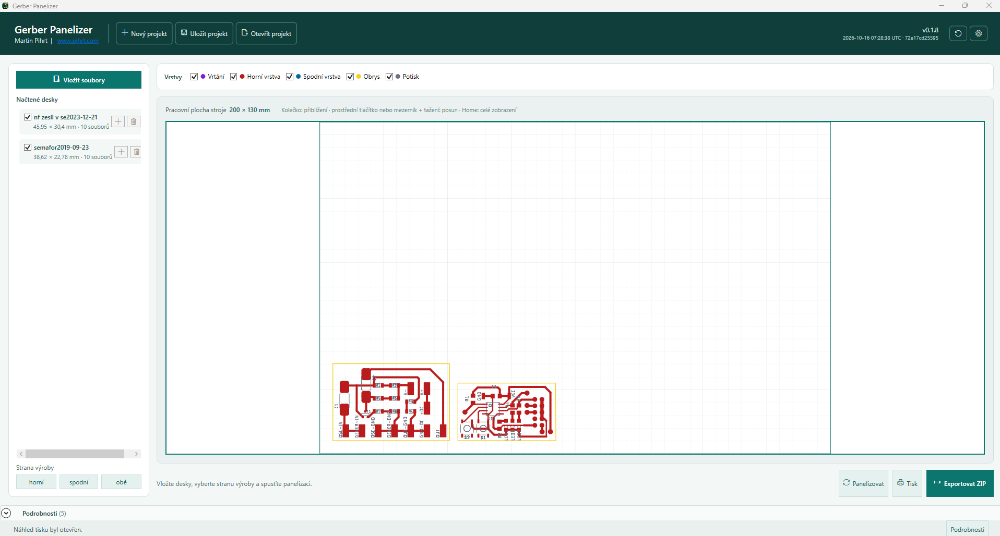
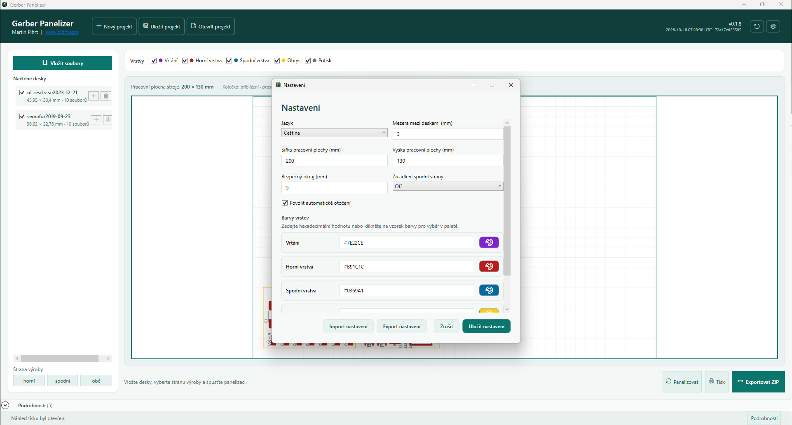

# Gerber Panelizer

## Verze 0.3.3 – 2026-11-09

Seznam načtených desek nyní používá přepínač viditelnosti a pro samostatně načtené výrobní vrstvy odvozuje smysluplný název místo textu `Imported layers`. Vypnutí desky okamžitě odstraní její umístění, vybraná strana výroby je zřetelně zvýrazněná a pravé kliknutí na umístěnou desku ukáže její název i načtené vrstvy. Náhled složitých Gerberů uchovává zpracovanou kresbu a statickou scénu, takže přesun, zoom ani živá dráha hlavy znovu nezpracovávají veškerou zdrojovou geometrii. Přímé řízení Wegstr přidává držení šipek pro X/Y, kláves `+`/`-` pro Z, uběhnutý čas vedle průběhu a výslovné potvrzení před pokračováním při varováních přípravy; nefunkční prostřední tlačítko `XY` bylo odstraněno. Nová panelizace také smaže předchozí stopu hlavy.

## Verze 0.3.2 - 2026-11-03

Verze 0.3.2 zobrazuje stav USB připojení Wegstru, po kliknutí trvale skryje přečtené bezpečnostní upozornění a přidává tlačítko **Obnovit operaci** vedle STOP. Obnovení bez pohybu os vypne vřeteno, vymaže neplatné měření a znovu ověří připravenost řadiče; pokud je řadič připravený, rovnou nabídne nové měření povrchu. Diagnostický log zapisuje každý paket měření povrchu a odpověď řadiče včetně polohy dotyku Z. Čítač Z vrácený řadičem se používá pouze pro mapu povrchu, nikdy nepřepíše pracovní souřadnici Z. Při měření povrchu zůstává vřeteno vypnuté. Plán měření vybírá z připravené obráběcí dráhy pouze rastrové buňky s pohybem X/Y pod pracovní rovinou Z0; bezpečný přejezd z 0,0 k desce se tedy nikdy neměří. Po dokončení měření se stroj vrátí na pracovní X/Y nulu v bezpečné výšce sondování nad deskou, zachová mapu nivelace, vybere `01-copper-isolation.txt`, nastaví průběh na nulu a povolí Start bez nutnosti obnovy operace. Změna nuly pouze osy Z po výměně nástroje mapu zachová; změna počátku X/Y, výslovné smazání měření, nově připravené operace nebo nový či otevřený projekt ji zruší. Po dokončení operace hlava vyjede nejméně 20 mm pro výměnu nástroje. Kompenzace nivelace se používá jen pro změřenou izolaci mědi; vrtání i ořez obrysu lze spustit bez měření povrchu. Náhled panelu při měření a frézování ukazuje živou polohu hlavy a stopu již provedeného pohybu s uživatelsky volitelnou barvou; obnovuje se nejvýše desetkrát za sekundu a nezpomaluje pohyb stroje. Příprava kompenzované dráhy probíhá mimo vlákno okna, lze ji zastavit a před zahájením frézování ukáže stav přípravy. Ruční rychloposuv zůstává v ověřeném rozsahu 1–100 %, protože test na COM6 ukázal, že frontování paketů nad 100 % může řadič zastavit. Souhrny připravených operací i chybové zprávy řadiče jsou přeložené, upozornění na bezpečnost je kompaktní a pauza vypíná vřeteno, které pokračování znovu zapne před obráběním. STOP nyní ruší také čekající sériový paket.

Kompenzace nivelace mění Z pouze během frézovacího pohybu X/Y se zapnutým vřetenem pod pracovní rovinou Z0. Úvodní najetí, zanoření, bezpečné přejezdy a návrat na nulu zůstávají bajtově stejné jako ověřený program bez kompenzace.

## Verze 0.3.1 - 2026-10-27

## Aktuální změny — 2026-10-27

Verze 0.3.1 přidává automatické měření povrchu a kompenzaci nivelace Wegstr. Změří jen buňky rastru, kterými procházejí připravené dráhy, první dotyk použije jako referenci Z a ke korekci každé buňky se přibližuje po jednom kroku Z v každém vzorku pohybu včetně nastavitelné kompenzace vůle. Simulátor nabízí předvídatelný nerovný povrch pro úplnou zkoušku bez stroje; skutečný řadič, zapojení sondy, směry os a volný pohyb je před výrobou stále nutné fyzicky ověřit.

Verze 0.3.0 přidává samostatnou záložku **Přímé řízení Wegstr**. Operace izolace, vrtání a obrysu připraví přímo z aktuálního panelu, v paměti je přeloží do ověřeného sériového protokolu Wegstr 3.2.0 a spustí je přes bezpečný výchozí simulátor nebo výslovně potvrzené připojení 9600 8N1. Ruční polohování X/Y/Z odpovídá původní aplikaci: tlačítko lze držet, při 1 % provede jedno stisknutí přesný krok a tlačítko 100 % slouží k rychlému najetí na desku; rychlost výroby se tím nemění.

Nastavení nyní ukládá pojmenované předvolby pracovních ploch pro více strojů. Aktivní plochu lze přepnout v rozbalovacím seznamu přímo v panelu vrstev; okamžitě se použije pro náhled, panelizaci, tisk i všechny exporty. Filtry vrstev mají podobu barevných tlačítek, která při vypnutí zešednou. Přibylo také tlačítko Export TrackMaker: vytvoří plochý ZIP se standardními Gerber a Excellon soubory s běžnými příponami vrstev pro import celé desky v TrackMakeru.

Verze 0.2.2 povolí pro jednoho uživatele Windows jen jednu instanci Gerber Panelizeru, a to i při kombinaci instalované a přenosné verze; další spuštění obnoví první okno. Je-li dostupná aktualizace, aplikace nabídne uložení zveřejněného Setup EXE nebo jeho stažení a okamžité spuštění instalace. Wegstr nyní ve výchozím stavu přidá obrys každé desky do programu izolace mědi v izolační hloubce, takže lze obrys naznačit a desku později ustřihnout bez samostatného vyříznutí.

Export Wegstr sjednotí podporované kruhové spoje a kruhové, obdélníkové nebo oválné pady vybrané měděné vrstvy a kolem výsledné mědi vypočte nastavené odsazení středu nástroje. Nesnaží se tiše převádět nepodporované Gerber oblouky, regiony, makra ani nekruhové apertury spojů. Před obráběním zkontrolujte všechny G-code programy v řídicím systému, počátek, průměry nástrojů, posuvy, otáčky i hloubky a proveďte zkušební chod nad obětovaným materiálem.

[](https://github.com/pihrt-com/gerber-panelizer/releases/latest)
[](https://github.com/pihrt-com/gerber-panelizer/releases/latest)
[](https://dotnet.microsoft.com/cs-cz/download/dotnet/8.0)
[](LICENSE)
[](SECURITY.cs.md)

[English](README.md) | **Česky**

Gerber Panelizer je odlehčená aplikace pro Windows pro přípravu výrobních panelů desek plošných spojů. Načte výrobní data exportovaná například z Autodesk Fusionu, zobrazí jejich vrstvy, rozmístí více desek na pracovní plochu frézky a vyexportuje jednu výrobní ZIP sadu Gerber a Excellon souborů.

> [!WARNING]
> **Aktuální vydání nejsou podepsaná certifikátem pro podepisování kódu.** Windows SmartScreen proto může ukázat upozornění jak u přenosného EXE, tak u instalačního MSI. Stahujte pouze z [GitHub Releases tohoto repozitáře](https://github.com/pihrt-com/gerber-panelizer/releases), ověřte zveřejněný SHA-256 kontrolní součet a spusťte soubor jen tehdy, když danému vydání důvěřujete. K řádnému odstranění upozornění je nutný veřejně důvěryhodný certifikát; i nově podepsaný vydavatel může potřebovat čas na vytvoření reputace SmartScreenu. Viz [bezpečnostní a instalační informace](SECURITY.cs.md).

## Stav projektu

Aplikace je připravená jako samostatné Windows x64 EXE. Bez závislosti na cloudové službě lokálně zpracovává běžné metrické i palcové vstupy RS-274X Gerber a Excellon.

## Snímky aplikace

### České rozhraní



Hlavní obrazovka zobrazuje načtené desky, viditelné výrobní vrstvy, pracovní plochu stroje, ovládání panelizace, náhled tisku, export ZIP a podrobnosti stavů.



V Nastavení lze zvolit jazyk, pojmenované předvolby pracovních ploch pro více strojů, bezpečný okraj, mezery mezi deskami, pravidlo zrcadlení Bottom, automatické otočení, barvy vrstev a import či export nastavení.

## Klíčové vlastnosti

- Import ZIP, RAR a samostatných souborů Gerber/Excellon.
- Interaktivní náhled vrstev s odkládací plochou zobrazenou ihned po importu, přepínači viditelnosti desek, přiblížením kolečkem myši, ručním přesouváním desek dovnitř i ven, podrobnostmi o desce a vrstvách po pravém kliknutí, souvislým vykreslením spojů pod 45°, kruhovými, obdélníkovými i oválnými SMT pady a nastavitelnými HEX barvami s klikací paletou.
- Pojmenované předvolby pracovních ploch frézek s rozměry X/Y, přepínané přímo v panelu vrstev; aktivní předvolba se shodně použije pro náhled, panelizaci, tisk a export.
- Volba Top, Bottom nebo obou stran; volitelné zrcadlení Bottom podle osy X nebo Y se shodně aplikuje na náhled, Gerber, Excellon, projekt i G-code.
- Export panelu do jedné výrobní ZIP sady s Gerbery jednotlivých vrstev a sloučeným Excellon vrtáním, včetně bezpečného potvrzení před přepsáním existujícího ZIPu a okna s cílovou cestou po úspěšném exportu.
- Samostatný export TrackMaker do plochého ZIPu s konvenčními příponami Gerber vrstev a Excellon vrtáním, určený pro import celé desky místo postupného importu jednotlivých vrstev.
- Podpora staršího palcového vrtání `M72`/`.drd` a jednoznačný desetinný metrický výstup Excellon pro spolehlivý import do TrackMakeru.
- Samostatný ZIP export Wegstr se soubory `01-copper-isolation.txt`, volitelným `02-drill.txt` a volitelným `03-board-outline.txt`; používá zápornou osu Y od levého horního počátku podle vzorků Wegstr a v Nastavení nabízí hloubky, odsazení izolace, průměr frézy obrysu, posuvy, otáčky a číslo nástroje. Ve výchozím stavu `01-copper-isolation.txt` také projede každý uzavřený obrys desky v izolační hloubce, aby šel obrys naznačit bez samostatného vyřezání.
- Přímé řízení Wegstr z aktuálního panelu se simulátorem, kontrolou odpovědí řadiče, funkcemi start/pauza/pokračování/STOP, pauzou při výměně nástroje, průběhem paketů a uběhnutým časem, ovládáním vřetena, upravitelnými pracovními souřadnicemi, nulováním, bezpečným návratem na nulu, ručním polohováním X/Y/Z myší nebo držením kláves, potvrzením varování při přípravě operací, automatickým měřením povrchu pod obráběcími drahami a plynulou kompenzací Z. Před výrobou je stále nutná fyzická přejímka konkrétního stroje a sondy.
- Postupný import, duplikování a mazání desek, přenositelné uložené projekty, podrobná diagnostika stavů, české, anglické, německé a francouzské rozhraní, náhled tisku samotného panelu a tisk.
- Vlastní ikona PCB vložená do EXE, titulku a hlavního panelu aplikace, včetně lokalizovaného potvrzení před ukončením, automatické kontroly vydání po spuštění s přímým stažením Setup EXE nebo stažením a instalací a ruční kontroly jedním tlačítkem vedle Nastavení.
- Rotovaný diagnostický log `gerber-panelizer.log` vedle spuštěného EXE; pokud je instalační složka chráněná proti zápisu, použije se `%LOCALAPPDATA%\GerberPanelizer\logs`.

## Dokumentace

- [Uživatelská příručka](docs/cs/PRIRUCKA_UZIVATELE.md)
- [G-code pro Wegstr: příkazy, příklady a omezení](docs/cs/WEGSTR_GCODE.md)
- [Přímé řízení Wegstr, ověřený protokol a bezpečnostní kontrola](docs/cs/WEGSTR_DIRECT_CONTROL.md)
- [User guide](docs/en/USER_GUIDE.md)
- [Technická architektura](docs/cs/ARCHITEKTURA.md)
- [Technical architecture](docs/en/ARCHITECTURE.md)

## Sestavení

Projekt vyžaduje .NET 8 SDK na Windows.

```powershell
dotnet build .\GerberPanelizer.sln
dotnet publish .\src\GerberPanelizer.App\GerberPanelizer.App.csproj -c Release -r win-x64 --self-contained true -p:PublishSingleFile=true -p:IncludeNativeLibrariesForSelfExtract=true -p:DebugType=None -p:DebugSymbols=false -o .\publish\win-x64
.\installer\build-installer.ps1
```

Po publikaci se spouští `GerberPanelizer.App.exe` ve složce `publish\win-x64`. Instalační skript vytvoří značkový Setup EXE i odpovídající MSI v `artifacts\installer`; nejdříve publikuje stejné samostatné EXE. Pro běžnou instalaci použijte Setup EXE s kvalitní ikonou PCB a licencí GPL-3.0. MSI zůstává k dispozici pro spravované nasazení a nabídne volbu zástupce na ploše a v nabídce Start; obě cesty transakčně nahradí starší instalaci Gerber Panelizeru a před vytvořením nového zástupce odstraní jeho starou variantu.

## Licence

Viz [LICENSE](LICENSE).
