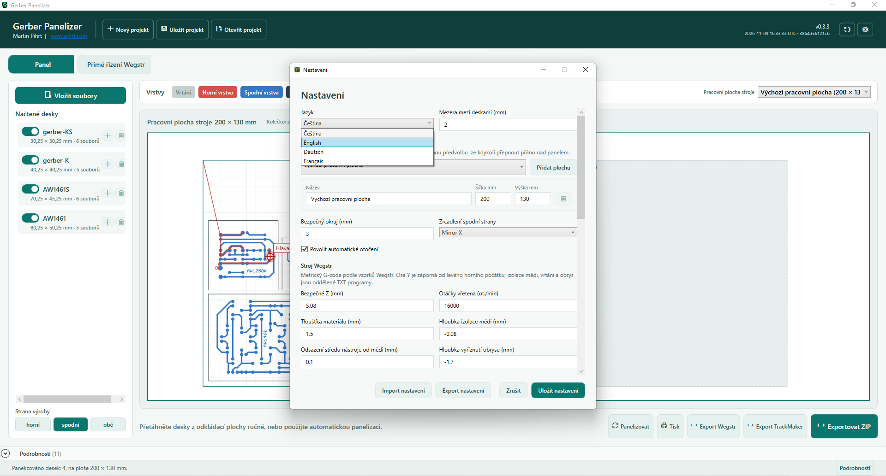
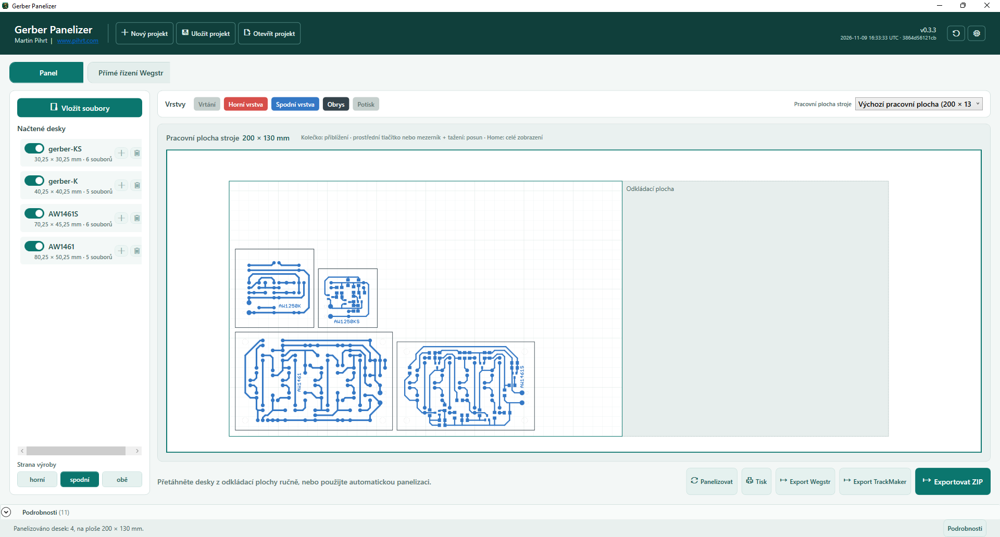
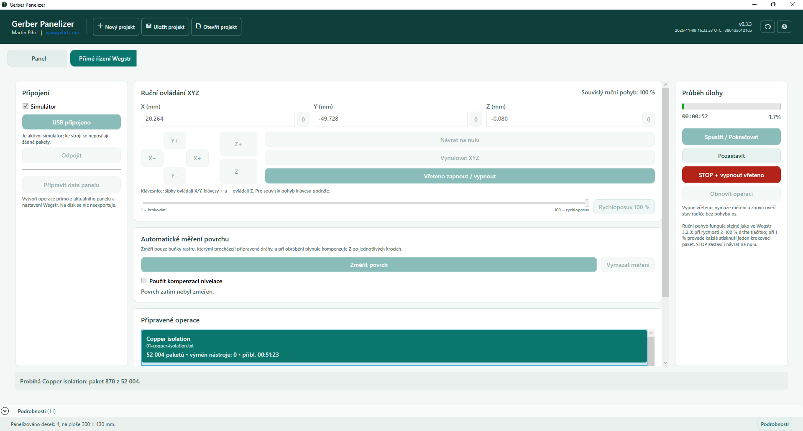
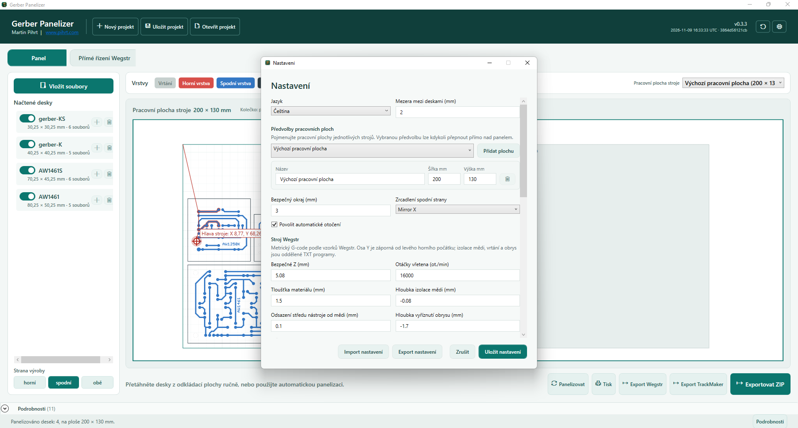
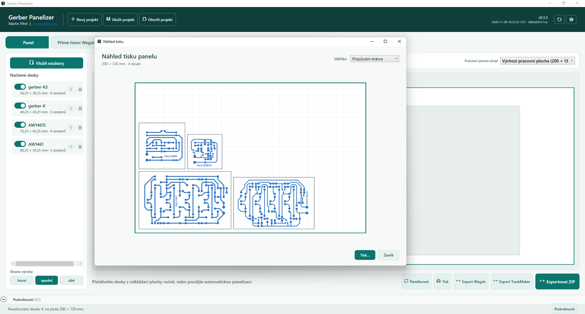

# Gerber Panelizer

## Verze 0.3.5 – 2026-11-11

Verze 0.3.5 vykresluje vyplněné oblasti Gerberu jako plochy, takže náhled nespojí sousední SMT plošky širokou aktivní aperturou. Výrobní data lze přetáhnout přímo na pracovní plochu, import přečte i výrobní ZIP uložený v jiném ZIPu a u Gerberu bez rozpoznaného názvu vrstvy vyžádá přiřazení vrstvy.

## Verze 0.3.4 – 2026-11-09

Verze 0.3.4 doplňuje všechny texty českého, anglického, německého a francouzského rozhraní a po změně jazyka ihned obnoví také dopočítávané údaje, například výchozí pracovní plochu, počty načtených souborů, stav USB, souhrny připravených operací, stav povrchu a režim ručního pohybu. Verze 0.3.3 přidala přepínač viditelnosti načtených desek, podrobnosti o umístěné desce, rychlejší vykreslování náhledu, polohování klávesnicí, uběhnutý čas úlohy, potvrzení varování při přípravě a mazání předchozí stopy hlavy při nové panelizaci.

[](https://github.com/pihrt-com/gerber-panelizer/releases/latest)
[](https://github.com/pihrt-com/gerber-panelizer/releases/latest)
[](https://dotnet.microsoft.com/cs-cz/download/dotnet/8.0)
[](LICENSE)
[](SECURITY.cs.md)

[English](README.md) | **Česky**

Gerber Panelizer je odlehčená aplikace pro Windows pro přípravu výrobních panelů desek plošných spojů. Načte výrobní data exportovaná například z Autodesk Fusionu, zobrazí jejich vrstvy, rozmístí více desek na pracovní plochu frézky a vyexportuje jednu výrobní ZIP sadu Gerber a Excellon souborů. Celé rozhraní je dostupné v češtině, angličtině, němčině a francouzštině.

> [!WARNING]
> **Aktuální vydání nejsou podepsaná certifikátem pro podepisování kódu.** Windows SmartScreen proto může ukázat upozornění jak u přenosného EXE, tak u instalačního MSI. Stahujte pouze z [GitHub Releases tohoto repozitáře](https://github.com/pihrt-com/gerber-panelizer/releases), ověřte zveřejněný SHA-256 kontrolní součet a spusťte soubor jen tehdy, když danému vydání důvěřujete. K řádnému odstranění upozornění je nutný veřejně důvěryhodný certifikát; i nově podepsaný vydavatel může potřebovat čas na vytvoření reputace SmartScreenu. Viz [bezpečnostní a instalační informace](SECURITY.cs.md).

## Stav projektu

Aplikace je připravená jako samostatné Windows x64 EXE. Bez závislosti na cloudové službě lokálně zpracovává běžné metrické i palcové vstupy RS-274X Gerber a Excellon.

## Snímky aplikace

### Rozhraní verze 0.3.3



Celé rozhraní lze přepínat mezi češtinou, angličtinou, němčinou a francouzštinou. Následující snímky zachycují české rozhraní verze 0.3.3.



Hlavní obrazovka zobrazuje načtené desky, viditelné výrobní vrstvy, pracovní plochu stroje, ovládání panelizace, náhled tisku, export ZIP a podrobnosti stavů.



Přímé řízení Wegstr připravuje operace z aktuálního panelu bez mezilehlého exportu a nabízí připojení, polohování, měření povrchu a řízení obrábění.



V Nastavení lze zvolit jazyk, pojmenované předvolby pracovních ploch pro více strojů, bezpečný okraj, mezery mezi deskami, pravidlo zrcadlení Bottom, automatické otočení, barvy vrstev a import či export nastavení.



## Klíčové vlastnosti

- Import ZIP, RAR a samostatných souborů Gerber/Excellon.
- Interaktivní náhled vrstev s odkládací plochou zobrazenou ihned po importu, přepínači viditelnosti desek, přiblížením kolečkem myši, ručním přesouváním desek dovnitř i ven, podrobnostmi o desce a vrstvách po pravém kliknutí, souvislým vykreslením spojů pod 45°, kruhovými, obdélníkovými i oválnými SMT pady a nastavitelnými HEX barvami s klikací paletou.
- Pojmenované předvolby pracovních ploch frézek s rozměry X/Y, přepínané přímo v panelu vrstev; aktivní předvolba se shodně použije pro náhled, panelizaci, tisk a export.
- Volba Top, Bottom nebo obou stran; volitelné zrcadlení Bottom podle osy X nebo Y se shodně aplikuje na náhled, Gerber, Excellon, projekt i G-code.
- Export panelu do jedné výrobní ZIP sady s Gerbery jednotlivých vrstev a sloučeným Excellon vrtáním, včetně bezpečného potvrzení před přepsáním existujícího ZIPu a okna s cílovou cestou po úspěšném exportu.
- Samostatný export TrackMaker do plochého ZIPu s konvenčními příponami Gerber vrstev a Excellon vrtáním, určený pro import celé desky místo postupného importu jednotlivých vrstev.
- Podpora staršího palcového vrtání `M72`/`.drd` a jednoznačný desetinný metrický výstup Excellon pro spolehlivý import do TrackMakeru.
- Samostatný ZIP export Wegstr se soubory `01-copper-isolation.txt`, volitelným `02-drill.txt` a volitelným `03-board-outline.txt`; používá zápornou osu Y od levého horního počátku podle vzorků Wegstr a v Nastavení nabízí hloubky, odsazení izolace, průměr frézy obrysu, posuvy, otáčky a číslo nástroje. Ve výchozím stavu `01-copper-isolation.txt` také projede každý uzavřený obrys desky v izolační hloubce, aby šel obrys naznačit bez samostatného vyřezání.
- Přímé řízení Wegstr z aktuálního panelu se simulátorem, kontrolou odpovědí řadiče, funkcemi start/pauza/pokračování/STOP, pauzou při výměně nástroje, průběhem paketů a uběhnutým časem, ovládáním vřetena, upravitelnými pracovními souřadnicemi, nulováním, bezpečným návratem na nulu, ručním polohováním X/Y/Z myší nebo držením kláves, potvrzením varování při přípravě operací, automatickým měřením povrchu pod obráběcími drahami a plynulou kompenzací Z. Před výrobou je stále nutná fyzická přejímka konkrétního stroje a sondy.
- Postupný import, duplikování a mazání desek, přenositelné uložené projekty, podrobná diagnostika stavů, české, anglické, německé a francouzské rozhraní, náhled tisku samotného panelu a tisk.
- Vlastní ikona PCB vložená do EXE, titulku a hlavního panelu aplikace, včetně lokalizovaného potvrzení před ukončením, automatické kontroly vydání po spuštění s přímým stažením Setup EXE nebo stažením a instalací a ruční kontroly jedním tlačítkem vedle Nastavení.
- Rotovaný diagnostický log `gerber-panelizer.log` vedle spuštěného EXE; pokud je instalační složka chráněná proti zápisu, použije se `%LOCALAPPDATA%\GerberPanelizer\logs`.

## Dokumentace

- [Uživatelská příručka](docs/cs/PRIRUCKA_UZIVATELE.md)
- [G-code pro Wegstr: příkazy, příklady a omezení](docs/cs/WEGSTR_GCODE.md)
- [Přímé řízení Wegstr, ověřený protokol a bezpečnostní kontrola](docs/cs/WEGSTR_DIRECT_CONTROL.md)
- [User guide](docs/en/USER_GUIDE.md)
- [Technická architektura](docs/cs/ARCHITEKTURA.md)
- [Technical architecture](docs/en/ARCHITECTURE.md)

## Sestavení

Projekt vyžaduje .NET 8 SDK na Windows.

```powershell
dotnet build .\GerberPanelizer.sln
dotnet publish .\src\GerberPanelizer.App\GerberPanelizer.App.csproj -c Release -r win-x64 --self-contained true -p:PublishSingleFile=true -p:IncludeNativeLibrariesForSelfExtract=true -p:DebugType=None -p:DebugSymbols=false -o .\publish\win-x64
.\installer\build-installer.ps1
```

Po publikaci se spouští `GerberPanelizer.App.exe` ve složce `publish\win-x64`. Instalační skript vytvoří značkový Setup EXE i odpovídající MSI v `artifacts\installer`; nejdříve publikuje stejné samostatné EXE. Pro běžnou instalaci použijte Setup EXE s kvalitní ikonou PCB a licencí GPL-3.0. MSI zůstává k dispozici pro spravované nasazení a nabídne volbu zástupce na ploše a v nabídce Start; obě cesty transakčně nahradí starší instalaci Gerber Panelizeru a před vytvořením nového zástupce odstraní jeho starou variantu.

## Licence

Viz [LICENSE](LICENSE).
