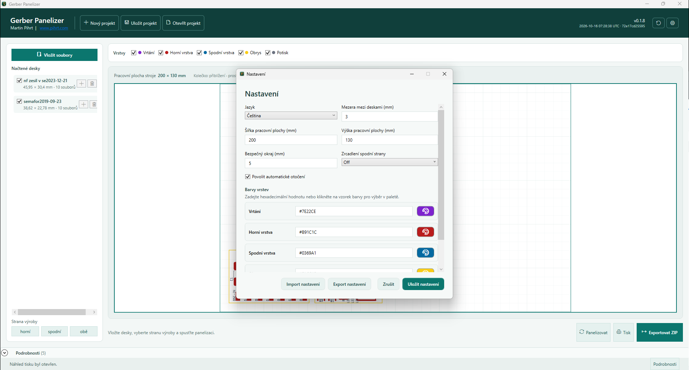

# Gerber Panelizer

## Kandidát verze 0.2.0 - 2026-10-16

Změny ve složce `C:\GitHub\gerber-panelizer`: bylo implementováno přesné zrcadlení Bottom a automatická rotace panelizace po 90 stupních v náhledu, Gerberu, Excellonu, uložených projektech i strojovém výstupu; byl opraven import staršího palcového vrtání `M72`/`.drd` a export jednoznačných desetinných metrických souřadnic Excellon pro TrackMaker; přibyl konfigurovatelný profil stroje Wegstr a oddělené TXT programy pro izolaci mědi, vrtání a volitelné vyříznutí obrysu.

Export Wegstr sjednotí podporované kruhové spoje a kruhové, obdélníkové nebo oválné pady vybrané měděné vrstvy a kolem výsledné mědi vypočte nastavené odsazení středu nástroje. Nesnaží se tiše převádět nepodporované Gerber oblouky, regiony, makra ani nekruhové apertury spojů. Před obráběním zkontrolujte všechny G-code programy v řídicím systému, počátek, průměry nástrojů, posuvy, otáčky i hloubky a proveďte zkušební chod nad obětovaným materiálem.

[](https://github.com/pihrt-com/gerber-panelizer/releases/latest)
[](https://github.com/pihrt-com/gerber-panelizer/releases/latest)
[](https://dotnet.microsoft.com/cs-cz/download/dotnet/8.0)
[](LICENSE)
[](SECURITY.cs.md)

[English](README.md) | **Česky**

Gerber Panelizer je odlehčená aplikace pro Windows pro přípravu výrobních panelů desek plošných spojů. Načte výrobní data exportovaná například z Autodesk Fusionu, zobrazí jejich vrstvy, rozmístí více desek na pracovní plochu frézky a vyexportuje jednu výrobní ZIP sadu Gerber a Excellon souborů.

> [!WARNING]
> **Aktuální vydání nejsou podepsaná certifikátem pro podepisování kódu.** Windows SmartScreen proto může ukázat upozornění jak u přenosného EXE, tak u instalačního MSI. Stahujte pouze z [GitHub Releases tohoto repozitáře](https://github.com/pihrt-com/gerber-panelizer/releases), ověřte zveřejněný SHA-256 kontrolní součet a spusťte soubor jen tehdy, když danému vydání důvěřujete. K řádnému odstranění upozornění je nutný veřejně důvěryhodný certifikát; i nově podepsaný vydavatel může potřebovat čas na vytvoření reputace SmartScreenu. Viz [bezpečnostní a instalační informace](SECURITY.cs.md).

## Stav projektu

Aplikace je připravená jako samostatné Windows x64 EXE. Bez závislosti na cloudové službě lokálně zpracovává běžné metrické i palcové vstupy RS-274X Gerber a Excellon.

## Poslední úprava — 2026-10-16

Změny ve složce `C:\Users\marti\OneDrive\Dokumenty\GitHub\gerber-panelizer`: přibyla zdokumentovaná galerie českého a anglického rozhraní se zobrazením panelizované pracovní plochy a okna Nastavení. Zdrojové obrázky jsou uložené ve složce `docs/images` pod stabilními popisnými názvy.

## Snímky aplikace

### České rozhraní


Hlavní obrazovka zobrazuje načtené desky, viditelné výrobní vrstvy, pracovní plochu stroje, ovládání panelizace, náhled tisku, export ZIP a podrobnosti stavů.



V Nastavení lze zvolit jazyk, rozměry pracovní plochy, bezpečný okraj, mezery mezi deskami, pravidlo zrcadlení Bottom, automatické otočení, barvy vrstev a import či export nastavení.

## Klíčové vlastnosti

- Import ZIP, RAR a samostatných souborů Gerber/Excellon.
- Interaktivní náhled vrstev s filtrováním, přiblížením celé pracovní plochy kolečkem myši, ručním přesouváním desek, souvislým vykreslením spojů pod 45°, kruhovými, obdélníkovými i oválnými SMT pady a nastavitelnými HEX barvami s klikací paletou.
- Nastavitelná pracovní plocha frézky, okraje, mezery a automatická rotace rozmístění po 90 stupních.
- Volba Top, Bottom nebo obou stran; volitelné zrcadlení Bottom podle osy X nebo Y se shodně aplikuje na náhled, Gerber, Excellon, projekt i G-code.
- Export panelu do jedné výrobní ZIP sady s Gerbery jednotlivých vrstev a sloučeným Excellon vrtáním, včetně bezpečného potvrzení před přepsáním existujícího ZIPu a okna s cílovou cestou po úspěšném exportu.
- Podpora staršího palcového vrtání `M72`/`.drd` a jednoznačný desetinný metrický výstup Excellon pro spolehlivý import do TrackMakeru.
- Samostatný ZIP export Wegstr se soubory `01-copper-isolation.txt`, volitelným `02-drill.txt` a volitelným `03-board-outline.txt`; používá zápornou osu Y od levého horního počátku podle vzorků Wegstr a v Nastavení nabízí hloubky, odsazení izolace, průměr frézy obrysu, posuvy, otáčky a číslo nástroje.
- Postupný import, duplikování a mazání desek, přenositelné uložené projekty, podrobná diagnostika stavů, české, anglické, německé a francouzské rozhraní, náhled tisku samotného panelu a tisk.
- Vlastní ikona PCB vložená do EXE, titulku a hlavního panelu aplikace, včetně lokalizovaného potvrzení před ukončením a kontroly vydání na GitHubu jedním tlačítkem vedle Nastavení.

## Dokumentace

- [Uživatelská příručka](docs/cs/PRIRUCKA_UZIVATELE.md)
- [User guide](docs/en/USER_GUIDE.md)
- [Technická architektura](docs/cs/ARCHITEKTURA.md)
- [Technical architecture](docs/en/ARCHITECTURE.md)

## Sestavení

Projekt vyžaduje .NET 8 SDK na Windows.

```powershell
dotnet build .\GerberPanelizer.sln
dotnet publish .\src\GerberPanelizer.App\GerberPanelizer.App.csproj -c Release -r win-x64 --self-contained true -p:PublishSingleFile=true -p:IncludeNativeLibrariesForSelfExtract=true -p:DebugType=None -p:DebugSymbols=false -o .\publish\win-x64
.\installer\build-installer.ps1
```

Po publikaci se spouští `GerberPanelizer.App.exe` ve složce `publish\win-x64`. Instalační skript vytvoří značkový Setup EXE i odpovídající MSI v `artifacts\installer`; nejdříve publikuje stejné samostatné EXE. Pro běžnou instalaci použijte Setup EXE s kvalitní ikonou PCB a licencí GPL-3.0. MSI zůstává k dispozici pro spravované nasazení a nabídne volbu zástupce na ploše a v nabídce Start; obě cesty transakčně nahradí starší instalaci Gerber Panelizeru.

## Licence

Viz [LICENSE](LICENSE).
