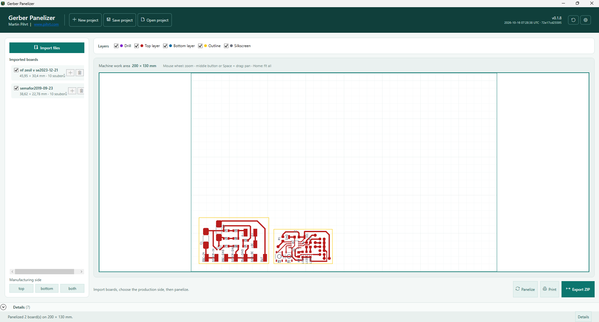
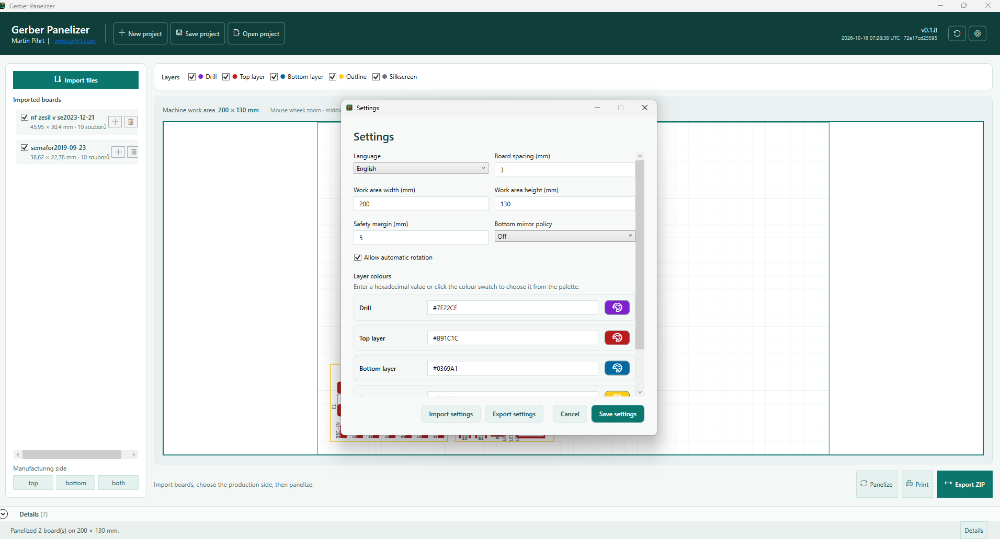

# Gerber Panelizer

[](https://github.com/pihrt-com/gerber-panelizer/releases/latest)
[](https://github.com/pihrt-com/gerber-panelizer/releases/latest)
[](https://dotnet.microsoft.com/en-us/download/dotnet/8.0)
[](LICENSE)
[](SECURITY.md)

**English** | [Česky](README.cs.md)

Gerber Panelizer is a lightweight Windows desktop application for preparing printed-circuit-board manufacturing panels. It imports manufacturing data exported from tools such as Autodesk Fusion, renders and filters the board layers, arranges multiple boards on a milling-machine work area, and exports one production ZIP package containing Gerber and Excellon files.

> [!WARNING]
> **Current releases are not code-signed.** Windows SmartScreen may therefore display a warning for both the portable EXE and the MSI installer. Download only from this repository's [GitHub Releases](https://github.com/pihrt-com/gerber-panelizer/releases), verify the published SHA-256 checksum, and run it only if you trust that release. A publicly trusted code-signing certificate is required to resolve this properly; even a newly signed publisher can need time to establish SmartScreen reputation. See the [security and installation notice](SECURITY.md).

## Project status

The application is implemented as a self-contained Windows x64 executable. It processes common metric and inch RS-274X Gerber and Excellon input locally without requiring a cloud service.

## Latest update — 2026-10-23

Version 0.2.4 fixes the Setup EXE updater by closing the temporary download before atomically replacing the final file. Both the user-selected download and Download and install paths therefore work without the Windows file-lock error.

Version 0.2.3 stores named work-area presets for multiple machines. The active work area can be switched in the drop-down directly in the layer panel and is immediately used by preview, panelization, printing, and every export. Layer filters are colour buttons that turn grey when disabled. A new TrackMaker export creates a flat ZIP with standard Gerber and Excellon files using conventional layer extensions for importing the complete board in TrackMaker.

Version 0.2.2 allows only one Gerber Panelizer process for each Windows user, including a mix of installed and portable builds; launching it again restores the first window. When an update is available, the application can save the published Setup EXE or download it and immediately start installation. Wegstr adds each board profile to the copper-isolation program by default, marking the outline at isolation depth for boards that will be cut manually instead of milled through.

## Screenshots

### English interface



The main screen shows imported boards, visible manufacturing layers, the machine work area, panelization controls, print preview, ZIP export, and status details.



Settings provide the interface language, named machine work-area presets, safety margin, board spacing, Bottom mirror policy, automatic rotation, individual layer colours, and settings import/export.

## Core capabilities

- Import ZIP, RAR, and individual Gerber/Excellon files.
- Interactive layer preview with an immediate post-import staging area, visibility filtering, mouse-wheel zoom, manual dragging into or out of the panel, continuous 45-degree trace rendering, circular, rectangular, and obround SMT pad flashes, and configurable HEX colours with a click-to-select palette.
- Named milling work-area presets with X/Y dimensions, switched directly in the layer panel; the active preset is used consistently for preview, panelization, printing, and export.
- Top, Bottom, or both-side production selection; optional Bottom Mirror X or Mirror Y is applied consistently to preview, Gerber, Excellon, project data, and G-code.
- Panel export as one production ZIP package containing per-layer Gerbers and merged Excellon drilling data, with safe confirmation before replacing an existing ZIP and a success dialog showing its final location.
- Separate TrackMaker export as a flat ZIP with conventional Gerber layer extensions and Excellon drilling data, intended for importing the complete board rather than importing layers one by one.
- Legacy inch `M72`/`.drd` drilling support and explicit decimal metric Excellon output for reliable TrackMaker import.
- Separate Wegstr ZIP export with `01-copper-isolation.txt`, optional `02-drill.txt`, and optional `03-board-outline.txt`; it uses negative Y from the top-left origin as in the supplied Wegstr samples and exposes depths, isolation offset, outline-cutter diameter, feeds, spindle speed, and tool number in Settings. By default, `01-copper-isolation.txt` also traces every closed board profile at isolation depth so its outline can be marked without generating a separate cut.
- Incremental import, board duplication/deletion, portable saved projects, detailed status diagnostics, Czech, English, German, and French UI, panel-only print preview, and printing.
- Custom PCB application icon embedded in the executable, title bar, and taskbar, a localized confirmation before exit, automatic GitHub Release checking after startup with direct Setup EXE download or download-and-install choices, and a retained manual update-check button beside Settings.
- Rotating `gerber-panelizer.log` diagnostics beside the launched executable; when the installation folder is not writable, the log falls back to `%LOCALAPPDATA%\GerberPanelizer\logs`.

## Documentation

- [User guide](docs/en/USER_GUIDE.md)
- [Wegstr G-code commands, examples, and limitations](docs/en/WEGSTR_GCODE.md)
- [Uživatelská příručka](docs/cs/PRIRUCKA_UZIVATELE.md)
- [Technical architecture](docs/en/ARCHITECTURE.md)
- [Technická architektura](docs/cs/ARCHITEKTURA.md)

## Wegstr safety boundary

The Wegstr exporter unions supported circular traces and circle, rectangle, or obround flashes from the selected copper layer, then offsets the resulting copper boundary by the configured tool-centre clearance. It rejects unsupported Gerber arcs and regions instead of silently approximating them, and skips unsupported trace apertures with a warning. Inspect every G-code program in the controller, confirm the work origin, tool-length offsets, cutter diameters, feeds, spindle speed, and depths, and perform a dry run above a sacrificial workpiece before machining.

## Build

The project requires the .NET 8 SDK on Windows.

```powershell
dotnet build .\GerberPanelizer.sln
dotnet publish .\src\GerberPanelizer.App\GerberPanelizer.App.csproj -c Release -r win-x64 --self-contained true -p:PublishSingleFile=true -p:IncludeNativeLibrariesForSelfExtract=true -p:DebugType=None -p:DebugSymbols=false -o .\publish\win-x64
.\installer\build-installer.ps1
```

After publishing, run `GerberPanelizer.App.exe` from `publish\win-x64`. The installer script produces a branded Setup EXE and a matching MSI in `artifacts\installer`; it first publishes the same self-contained EXE. Use the Setup EXE for the branded installer experience with the high-resolution PCB icon and GPL-3.0 license. The MSI remains available for managed deployments and offers Desktop/Start-menu shortcut choices; both paths transactionally replace a previous Gerber Panelizer version and remove the old shortcut variant before creating the selected one.

## License

See [LICENSE](LICENSE).

