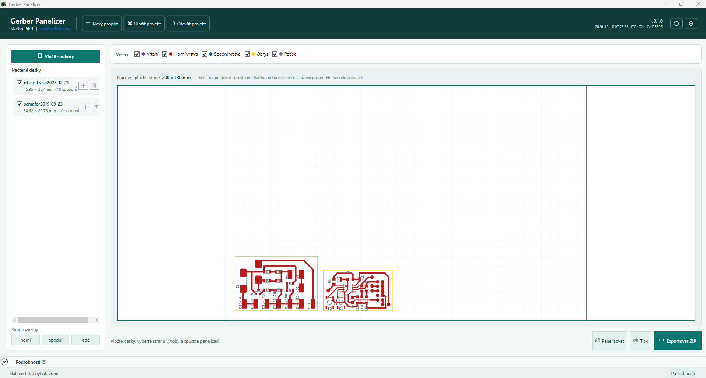
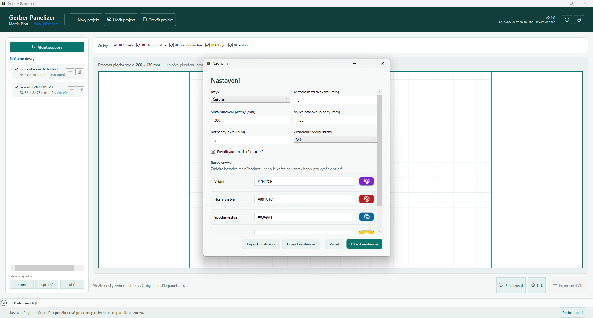
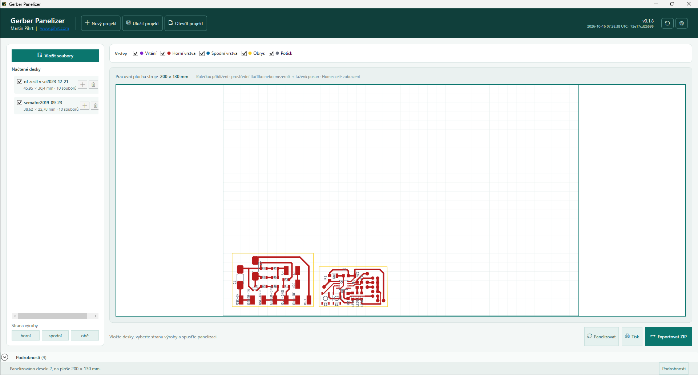

# Uživatelská příručka Gerber Panelizer

## Novinky ve verzi 0.2.1
Importované desky se ihned vykreslí na odkládací ploše vedle pracovní plochy stroje. Desku lze přetáhnout dovnitř panelu, ručně ji umístit nebo ji vrátit ven; automatické rozmístění tlačítkem **Panelizovat** zůstává k dispozici. Export a tisk zahrnou jen celé desky uvnitř pracovní plochy a upozorní na desku přesahující její hranici. Po spuštění se automaticky zkontroluje nové vydání, přičemž ruční tlačítko kontroly zůstává zachováno. Aktualizovaný instalátor před vytvořením vybraného zástupce uklidí jeho starou variantu. Chyby a pády se zapisují do místního diagnostického logu včetně stack trace.

## Proč Gerber Panelizer
Gerber Panelizer spojí více výrobních zakázek DPS do jednoho panelu pro CNC frézku nebo jiný kompatibilní výrobní postup. Pracuje lokálně na počítači s Windows. Zdrojové soubory se nikam neodesílají. Výstupem je jedna výrobní ZIP sada. Obsahuje jeden Gerber soubor pro každou vybranou výrobní vrstvu a jeden Excellon soubor pro vrtání.

## Založení panelu
1. Spusťte `GerberPanelizer.App.exe`.
2. V Nastavení otevřeném ikonou ozubeného kola nastavte šířku a výšku pracovní plochy frézky, například 200 × 130 mm.
3. Tlačítkem **Vložit soubory** vyberte ZIP z Fusionu/EAGLE, RAR nebo samostatné Gerber a Excellon soubory. Později jej můžete použít znovu pro přidání dalších desek.
4. Potvrďte, zda je panel určený pro Top, Bottom, nebo obě strany.
5. Importované desky se ihned zobrazí na odkládací ploše vedle pracovní plochy. Přetáhněte je ručně dovnitř, nebo zvolte **Panelizovat** pro automatické rozmístění.
6. Výsledek ověřte filtry vrstev a náhledem, potom tlačítkem **Export** vytvořte výrobní ZIP sadu, tlačítkem **Export Wegstr** samostatný G-code balíček nebo otevřete **Přímé řízení Wegstr** a připravte aktuální panel pro simulátor či připojený řadič.

V horní liště použijte **Nový projekt**, **Uložit projekt** a **Otevřít projekt**, chcete-li rozdělaný panel dokončit později. Projekt uloží relativní cesty ke zdrojovým archivům nebo souborům, zvolené desky i jejich ruční umístění; při přesunu na jiný počítač jej ponechte vedle zdrojových výrobních dat.

## Import výrobních dat
Export Autodesk Fusion/EAGLE obvykle obsahuje složky `GerberFiles`, `DrillFiles` a `Assembly`. Aplikace používá pro výrobu Gerber a vrtací data. Montážní BOM a pick-and-place soubory se záměrně ignorují.
Importer rozpoznává běžné názvy vrstev z Fusionu, například `copper_top`, `copper_bottom`, `profile`, `silkscreen_top`, `silkscreen_bottom`, `soldermask_top`, `soldermask_bottom`, `solderpaste_top` a `solderpaste_bottom`. Vrstva `profile` zachovává všechny kontury a výřezy; není nahrazena obdélníkem. Pokud archiv obsahuje neznámý název vrstvy, před panelizací zkontrolujte souhrn importu. Neexportujte zakázku, dokud nejsou všechny vrstvy potřebné pro cílový stroj správně rozpoznané.

## Pracovní plocha a panelizace
Pracovní plocha představuje využitelnou oblast stroje, ne nutně fyzický rozměr podkladové desky. Nastavte bezpečný okraj vůči upínkám a limitům stroje a poté mezeru mezi deskami podle průměru frézy a způsobu oddělení.
Po importu jsou všechny desky viditelné na šedé odkládací ploše napravo. Kliknutím a tažením je můžete přemístit na pracovní plochu, uvnitř ní i zpět ven. Export a tisk zpracují jen desky, které jsou uvnitř celé; deska protínající hranici export zablokuje, aby nevznikla neúplná výrobní data.
Automatická panelizace začíná v bezpečné oblasti a umístí desky včetně úplného obrysu, vrtání a zvolených vrstev. Pokud je povolená automatická rotace, může desku otočit o 90 stupňů, aby se vešla. Desky, které se nevejdou, zůstanou viditelné na odkládací ploše. Stejná rotace se použije v náhledu, Gerberu, Excellonu, uloženém projektu i výstupu Wegstr.
Kolečko myši přibližuje v místě ukazatele. Prostřední tlačítko nebo mezerník + tažení posouvá náhled a Home zobrazí pracovní i odkládací plochu. V seznamu načtených desek použijte Duplikovat nebo Smazat, případně stiskněte Delete. Pokud chcete ruční umístění nahradit automatickým, spusťte Panelizovat znovu.

## Aktualizace programu
Po zobrazení hlavního okna aplikace automaticky zkontroluje nejnovější vydání na GitHubu. Pokud je dostupná novější verze, nabídne otevření stránky pro stažení. Když je verze aktuální nebo se kontrola kvůli síti nezdaří, automatická kontrola neotevírá rušivé dialogové okno; výsledek zůstane ve stavovém řádku. Tlačítko ruční kontroly vedle Nastavení zůstává dostupné a zobrazuje i potvrzení aktuální verze nebo chybu spojení.

## Top, Bottom a zrcadlení
Gerberové vrstvy Top a Bottom obvykle používají stejný souřadnicový systém desky. Samotná volba Bottom proto data nezrcadlí; zrcadlení se provede jen při nastavení Mirror X nebo Mirror Y. Zvolená transformace kolem středu každé desky se shodně použije v náhledu, Gerberu, vrtání Excellon, uloženém projektu i G-code Wegstr.
Před výrobou neznámé zakázky vyexportujte zkušební panel a ověřte orientaci na obětované desce. Kontrolujte zejména texty, konektory a nesymetrické rozmístění otvorů.

## Náhled vrstev
Tlačítky vrstev nad pracovní plochou zobrazíte nebo skryjete vrtání, měď, profil, potisk, nepájivou masku a pájecí pastu. Barvy nastavíte v Nastavení; nemění výrobní data.
Náhled pomáhá s přípravou. Výrobní stroj je stále konečnou autoritou pro výběr nástroje, nulový bod, upnutí, vřeteno a bezpečnost materiálu.

## Nastavení a přenositelnost
Nastavení zahrnuje pracovní plochu, bezpečnostní okraje, mezery, automatickou rotaci, barvy vrstev, jazyk, pravidlo zrcadlení Bottom a profil stroje Wegstr. Profil Wegstr obsahuje bezpečné Z, tloušťku materiálu, hloubky izolace, vrtání a obrysu, odsazení izolace, průměr frézy obrysu, posuvy, otáčky, číslo nástroje, volby zahrnutí operací, rastr měření, bezpečné Z měření a kompenzaci vůle Z. Aplikace tyto hodnoty uloží pro aktuálního uživatele Windows.

Použijte **Exportovat nastavení** pro uložení přenosné konfigurace a **Importovat nastavení** pro její obnovu na jiném počítači. Importované nastavení považujte za profil stroje: před prvním použitím vždy ověřte rozměry a pravidlo zrcadlení.

## Přímé řízení Wegstr

Samostatná záložka **Přímé řízení Wegstr** použije aktuální panel a profil Wegstr bez ukládání mezilehlého souboru. Během přípravy a kontroly operací ponechte zapnutý simulátor. Ruční ovládání X/Y/Z podporuje souvislý pohyb při držení tlačítka na 2–100 %, jeden krokovací paket na stisknutí při 1 % a samostatný rychloposuv 100 % pro najetí nad desku; ruční nastavení nemění řezné ani vrtací posuvy. Záložka dále nabízí úpravu pracovních souřadnic, nulování jednotlivých os i XYZ, ovládání vřetena, bezpečný návrat na nulu, start, pauzu/pokračování, STOP, zastavení při výměně nástroje, průběh paketů, automatické měření povrchu a volitelnou kompenzaci nivelace.

Připravte panel, připojte simulátor a zvolte **Změřit povrch**. Změří se pouze buňky rastru projeté připravenými drahami; po dokončení zkontrolujte počet bodů a rozsah korekce a teprve potom spusťte program se zapnutou kompenzací. Nová příprava nebo změna pracovních souřadnic měření vymaže. Podrobný postup, protokol, porovnání s původní aplikací a kontrolní seznam fyzické přejímky popisuje dokument [Přímé řízení Wegstr](WEGSTR_DIRECT_CONTROL.md).

## Tisk
V Náhledu tisku ověřte měřítko a viditelné vrstvy, potom tiskněte přes standardní dialog Windows. Náhled i tisková úloha obsahují pouze pracovní plochu DPS, nikoli okno programu. Před tiskem vyberte Přizpůsobit stránce, skutečnou velikost, 75 % nebo 50 %, vypněte škálování tiskárny a změřte známou referenční vzdálenost. Výtisk slouží pro kontrolu nebo ruční šablonu, není to export pro stroj.

## Podrobnosti stavů
Stavový řádek zobrazuje poslední operaci. Tlačítkem Podrobnosti přímo nad ním otevřete jednotlivá varování importu nebo exportu včetně názvu zdrojového souboru a zprávy parseru či exportu. Varování před odesláním výrobních dat do stroje zkontrolujte.

Varování, zachycené chyby, chyby úloh na pozadí a neočekávané pády se zapisují do `gerber-panelizer.log`. Přenosná verze jej vytváří vedle spuštěného EXE. Pokud Windows nedovolí zápis do instalační složky, například v `Program Files`, použije aplikace `%LOCALAPPDATA%\GerberPanelizer\logs`. Po dosažení 2 MB se předchozí obsah přesune do `gerber-panelizer.previous.log`. Log může obsahovat místní cesty k souborům a podrobnosti výjimek; před jeho předáním tyto údaje zkontrolujte.

## Řešení potíží

| Příznak | Doporučený postup |
| --- | --- |
| Chybí vrstva | Ověřte, že soubor obsahuje zdrojový archiv, a zkontrolujte jeho klasifikaci v souhrnu importu. |
| Umístění desky bylo odmítnuto | Zvětšete pracovní plochu nebo zmenšete okraje, mezery či omezení rotace. |
| Bottom strana je obrácená | Zkontrolujte pravidlo zrcadlení Bottom. |
| Stroj export odmítá | Zachovejte zdrojový archiv, ověřte názvy vrstev a vrtání očekávané strojem a proveďte malý testovací panel. |

## Bezpečnostní upozornění
Gerber Panelizer připravuje souřadnicová data a ze samostatné záložky Wegstr může ovládat připojený stroj. Simulátor je výchozí a fyzické připojení vyžaduje výslovné potvrzení portu, tato opatření však nenahrazují dostupné nouzové zastavení ani dohled obsluhy. Před každou úlohou ověřte rozměry, kalibraci, směry os, počátek, průměry nástrojů, materiál, upnutí, bezpečné Z a volný prostor vřetena.
